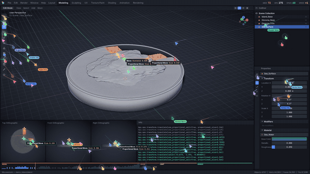
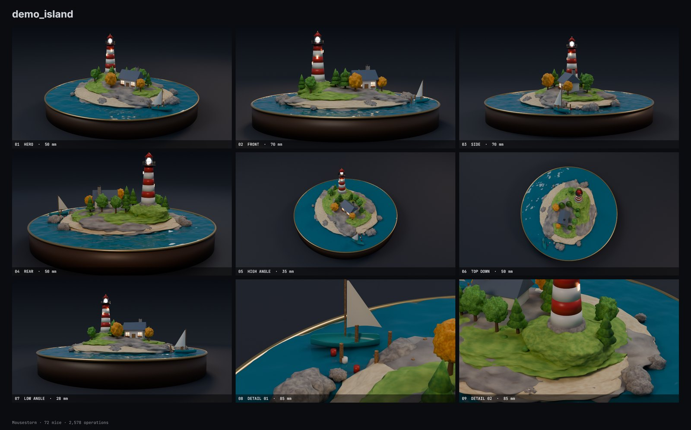

# Mousestorm

**Drop in a `.blend`. A swarm of mice builds it on camera. Get a film.**

[中文说明](README.zh-CN.md)

> **Experimental.** This is an early release that has been tested on a small number of scenes, mostly on Windows. Expect bugs. Reports, and `.blend` files that break it, are very welcome.



AI tools can now produce finished Blender files in seconds, and nobody ever sees the work happen. Mousestorm stages it: dozens of cursors pour into a modelling workspace and rebuild your file in parallel — placing objects, pulling vertices, sculpting, wiring shader nodes, dragging sliders, painting materials — before Cycles renders the result and the film ends on a full multi-camera photo shoot.

Everything it shows comes from your file: the real object names, transforms, modifier stacks, material node graphs and geometry. A `.blend` keeps the result and not the history, so the modelling steps themselves are inferred: names and values come from measuring the geometry, and they are good guesses rather than a record. For a film that shows exactly what was done, see [step logs](#optional-a-step-log).

- **One step.** Drag a file onto the app, pick a format, press start.
- **Many formats.** MP4, WebM, MOV (ProRes), GIF, animated WebP or a PNG sequence.
- **Adjustable speed, or just name a length.** ×0.05 to ×40, from a single mouse to several hundred. Ask for a 30-second film and the speed is worked out for you.
- **Wide, phone and square.** Portrait and square output get their own stacked workspace and their own camera framing, not a crop.
- **All kinds of mice.** Arrows, darts, pixel-art pointers, hollow neon ones, shared-document cursors and the occasional actual mouse, each with its own hand: overshoot, tremor and working gestures that match the tool (scribbled sculpt strokes, straight knife cuts, sliding edge loops).
- **A generated score.** Music that builds with the work and lands on the first frame of the finale, over clicks panned to where each mouse is on screen. Mastered to −16 LUFS. All synthesized; there are no samples to license.
- **Handles what AI actually outputs.** Hundreds of scripted primitives with modifiers, or a single dense image-to-3D mesh with vertex colours or textures.
- **Finds your hardware by itself.** Detects the CPU, memory and GPU. Renders on an idle GPU and leaves one that is busy alone, so it can sit beside a training job.

## Quick start

```bash
git clone https://github.com/Dennisyu-m/Mousestorm.git
```

There are two ways to use it: a **web app** that runs on your own computer, and a **command line**. The web app needs no setup beyond the first run; nothing is uploaded anywhere.

You need [Blender](https://www.blender.org/download/) and Python 3.10+. Developed and tested on Blender 5.2 on Windows; 4.2 is the oldest version accepted, and older releases and other platforms have not been run end to end yet. `mousestorm doctor` reports what it finds on your machine.

**Windows:** double-click `Mousestorm.bat`, or drop a `.blend` onto it.

**macOS / Linux:**

```bash
./mousestorm.sh
```

The first run creates a virtual environment and installs the dependencies. The app then opens at `http://127.0.0.1:7878`.

Blender is found automatically in the usual install locations. If yours is elsewhere, set `MOUSESTORM_BLENDER` or pass `--blender /path/to/blender`.

## What it needs, and how long it takes

**A GPU is strongly recommended.** With only a 4-core CPU a film can take well over an hour. Rendering runs on the GPU when there is one; composing the frames always uses the CPU.

Measured on a 43-second 1080p60 film of a 77,000-vertex scene:

| Hardware | Quality | Time |
|---|---|---|
| 8 CPU threads + 1 GPU | standard | 11 min |
| 16 CPU threads + 1 GPU | standard | 6 min |
| 16 CPU threads, no GPU | standard | 42 min |
| 8 CPU threads, no GPU | draft | 33 min |

These were measured with a server CPU limited to that many threads and a 48 GB workstation GPU, so a typical gaming GPU will be slower. A heavy scene takes longer: a 1,000,000-vertex scene took about 15 minutes with the same GPU. Re-filming the same file with different speed or style reuses the rendered shots and takes a few minutes.

Hardware is detected automatically. To see what was found:

```bash
mousestorm devices
```

`--device auto` is the default: an idle GPU if there is one, otherwise the CPU. Use `--device cpu` to keep the GPU free, or `--device gpu --gpu 2` to choose a card. The app has the same choices under **Render with**. On a machine short of memory, fewer frames are rendered at once rather than failing.

## Command line

```bash
python -m mousestorm scene.blend -o film.mp4 --speed 4 --mice 128
python -m mousestorm scene.blend -a 9:16 -d 30         # a 30-second vertical film
python -m mousestorm scenes/ -o films/ -q draft        # every .blend in a folder
python -m mousestorm doctor                            # check your setup
```

| Option | Default | Meaning |
| --- | --- | --- |
| `-f, --format` | from `-o`, else `mp4` | `mp4` `webm` `mov` `gif` `webp` `png` |
| `-s, --speed` | `1` | How fast the mice work; higher means a shorter film |
| `-d, --duration` | off | Target film length in seconds; sets the speed for you |
| `-m, --mice` | auto | Number of mice |
| `-q, --quality` | `standard` | `draft` `standard` `high` (Cycles samples) |
| `-r, --res` | `1080p` | `720p` `1080p` `1440p` `4k` (the short side) or `WxH` |
| `-a, --aspect` | `16:9` | `16:9`, `9:16`, `1:1`, ... |
| `--fps` | `60` | Frame rate |
| `--showcase` | `20` | Length of the finale, in seconds |
| `--lighting` | `auto` | `auto` `studio` `file` |
| `--device` | `cpu` | Set to `gpu` to let Cycles use your GPU |
| `--soundtrack` | `score` | `score` (music and clicks), `clicks`, `off` |
| `--no-sound` | off | Same as `--soundtrack off` |
| `--no-cache` | off | Always re-render the Cycles shots |
| `--workers`, `--threads` | 55% of cores | CPU budget for frames and for Cycles |

Next to the film you also get `NAME_stills/` (full-resolution photos from every camera) and `NAME_contact_sheet.png`.

**Trying other speeds is cheap.** The Cycles shots are cached by file content and camera setup, so re-filming the same scene at a new speed or mouse count skips straight past the slow part. An interrupted render resumes where it stopped. The cache lives in your user cache folder, is capped at 6 GB (`MOUSESTORM_CACHE_GB`) and can be moved with `MOUSESTORM_CACHE`.

**Lighting.** `auto` uses a built-in studio rig unless the file has an HDRI or at least three lights, since generated files usually carry only a default sun. `file` always keeps the lighting in your file.

## Looks and advanced settings

```bash
python -m mousestorm scene.blend -p neon                      # a ready-made look
python -m mousestorm scene.blend --set look.theme=paper --set camera.lens=85
python -m mousestorm scene.blend -c film.toml                 # or keep it all in a file
python -m mousestorm scene.blend --storyboard                 # six panels in seconds, no render
```

Presets: `shorts`, `cinema`, `neon`, `blueprint`, `noir`, `paper`, `hacker`, `pure`, `quick`. Themes change the whole workspace and viewport; colour grades, bloom, vignette and grain finish the picture; 70-odd options cover the mice, the pacing, the camera, the finale, Cycles, the soundtrack (mood, tempo, your own music file) and encoding. They all appear in the app's **Advanced settings** panel. The full list is in [docs/OPTIONS.md](docs/OPTIONS.md).

Next to the film you also get `NAME_poster.png`, a long-exposure light-painting of every mouse's path, and `NAME_report.json` with the numbers. MP4, MOV and WebM files carry chapter markers.

## Optional: a step log

Without one, the operations in the film are inferred from the geometry, which is plenty for everyday use. For a professional demonstration, have the AI keep a step log while it models and pass it along: the film then uses the recorded names, order and values. See [STEPS_FORMAT.md](docs/STEPS_FORMAT.md).

```bash
mousestorm model.blend --steps model.msteps
```

## How it works

```
.blend ──► extract ──► choreograph ──► Cycles beauty ──► frames ──► encode
          (Blender)      (Python)        (Blender)      (CPU pool)  (ffmpeg)
```

1. **Extract.** Headless Blender evaluates the scene — modifiers, instances, curves, text — and flattens it into arrays plus a JSON description. Scripts embedded in the file are not executed (`--disable-autoexec`).
2. **Choreograph.** There is no build history in a finished file, so one is reverse-engineered. Each object starts as a primitive at the 3D cursor and is moved, rotated and scaled into place. Its surface is split into spatially coherent patches, each one a job for one mouse; dense meshes go through a smoothed blockout first so that detail emerges the way it does in sculpting. A list scheduler assigns everything to the swarm, and every mouse's path is baked.
3. **Beauty.** Cycles renders the hero shot, the other camera angles (with close-ups aimed at parts it has checked are actually visible) and a turntable. The turntable is rendered sparsely and filled in with view interpolation: because the exact geometry is known, each in-between pixel is traced to its point in the world and looked up in the two neighbouring renders, so it stays sharp where a cross-dissolve would show a double image.
4. **Frames.** Each frame is a pure function of the plan and the time, so frames render out of order across a pool of processes. The viewport is a software rasterizer compiled with [numba](https://numba.pydata.org/), and the interface is drawn with [Skia](https://skia.org/).
5. **Encode.** Frames go straight to ffmpeg without touching the disk. Every click on the soundtrack is an actual operation in the film.

The mouse motion is not a recording of human behaviour and doesn't try to be exact. It is a plausible, sped-up interpretation of how the model could have been made.

## Robustness

Damaged files, files with no geometry and a machine short of disk space produce a plain message rather than a stack trace. Non-finite vertices from a generator are repaired. Scenes at millimetre scale and scenes far from the origin both frame correctly. If a worker process is killed (usually by running out of memory) the job stops and says so instead of hanging.

## Development

```bash
pip install -e ".[dev]"
python -m pytest tests -q
```

The unit tests need no Blender. `examples/make_torture.py` builds the awkward scenes used for manual end-to-end runs.

## Examples



`examples/` holds scripts for two test scenes, one for each kind of AI output:

```bash
blender -b --factory-startup -P examples/make_demo_island.py -- examples/demo_island.blend
blender -b --factory-startup -P examples/make_demo_shell.py -- examples/demo_shell.blend
```

## Acknowledgements

The idea of a swarm of cursors rebuilding something in front of you comes from the web: [Swarm Rebuild](https://github.com/DhvanilPatel/swarm-cursors), a browser extension that redraws any page this way, itself a tribute to Swarm by [Joel Califa](https://joelcalifa.com). Mousestorm brings the idea to 3D modelling and shares no code with either.

## Licence

Mousestorm is free software under the **GNU General Public License v3.0 or later**; see [LICENSE](LICENSE). The scripts in `mousestorm/bscripts/` use Blender's Python API, and [Blender's licensing](https://www.blender.org/about/license/) requires such scripts to be distributed under the GPL.

Your `.blend` files and everything Mousestorm renders from them remain yours. The GPL does not apply to that output.

Bundled fonts: [Inter](https://github.com/rsms/inter) and [JetBrains Mono](https://github.com/JetBrains/JetBrainsMono), both under the SIL Open Font License (`mousestorm/assets/fonts/`).

Blender is a trademark of the Blender Foundation. Mousestorm is an independent project, and is not affiliated with or endorsed by the Blender Foundation. The workspace in the film is an original design and uses no Blender logos or artwork.
