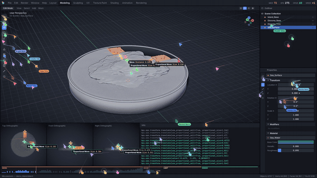
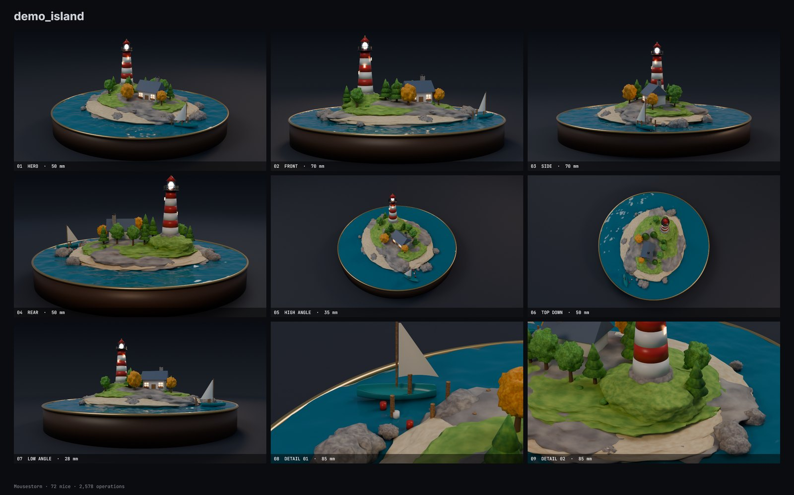

# Mousestorm

**拖入一个 `.blend`，一大群鼠标当着镜头把它搭出来，输出一部影片。**

[English](README.md)

> **实验阶段。** 这是早期版本，只在少量场景上测试过，主要是 Windows，很可能有 bug。欢迎反馈问题，也欢迎提供会让它出错的 `.blend` 文件。



现在 AI 几秒钟就能生成完整的 Blender 文件，但没人看得到“做出来”的过程。Mousestorm 把这个过程演出来：几十上百个光标涌进建模工作区，并行地重建你的文件。它们摆放物体、拖顶点、雕刻、连材质节点、拖滑块、上色，最后由 Cycles 渲染成品，并以一场全方位多机位拍摄收尾。

画面里的内容全部来自你的文件：真实的物体名、变换参数、修改器堆栈、材质节点图和几何体。

- **一步完成。** 把文件拖进页面，选好格式，点开始。
- **多种格式。** MP4、WebM、MOV（ProRes）、GIF、动画 WebP 或 PNG 序列。
- **速度可调，也可以直接指定时长。** ×0.05 到 ×40，鼠标从一只到几百只。想要 30 秒的片子，速度会自动算好。
- **横屏、竖屏、方形。** 竖屏和方形有专门的堆叠式工作区和镜头构图，不是简单裁切。
- **各种鼠标。** 箭头、飞镖、像素风指针、空心霓虹指针、协作文档式光标，偶尔还有真的小老鼠。每只手感都不同：会冲过头再修正，手会微微抖动，动作也贴合工具（雕刻是来回涂抹，刀具是直线切割，循环边是沿边滑动）。
- **程序生成的配乐。** 音乐随工作进度推进，正好落在结尾展示的第一帧；点击声按每只鼠标的屏幕位置做左右声像。响度母带到 −16 LUFS。全部实时合成，没有需要授权的采样。
- **适配 AI 的真实产物。** 不管是几百个带修改器的脚本基础体，还是图生 3D 导出的单个高密度网格（顶点色或贴图），都能处理。
- **自动识别硬件。** 自动检测 CPU、内存和显卡；有空闲显卡就用它渲染，正在被占用的显卡不会碰，可以和训练任务同时跑。

## 快速开始

```bash
git clone https://github.com/Dennisyu-m/Mousestorm.git
```

有两种用法：在你自己电脑上运行的**网页版**，和**命令行版**。网页版除首次运行外无需配置，文件不会上传到任何地方。

需要 [Blender](https://www.blender.org/download/) 和 Python 3.10+。目前在 Windows 的 Blender 5.2 上开发和测试；程序接受的最低版本是 4.2，更旧的版本和其他系统尚未完整跑过。运行 `mousestorm doctor` 可以查看本机环境。

**Windows：** 双击 `Mousestorm.bat`，或把 `.blend` 文件拖到它上面。

**macOS / Linux：**

```bash
./mousestorm.sh
```

首次运行会自动创建虚拟环境并安装依赖，然后在 `http://127.0.0.1:7878` 打开页面。

程序会在常见安装位置自动查找 Blender。如果装在别处，请设置 `MOUSESTORM_BLENDER` 环境变量，或传入 `--blender 路径`。

## 硬件要求和耗时

**强烈建议有显卡。** 只有 4 核 CPU 的话，一部片子可能要一个多小时。精渲会用显卡；合成画面这一步始终用 CPU。

实测一部 43 秒、1080p60、7.7 万顶点场景的影片：

| 硬件 | 画质 | 耗时 |
|---|---|---|
| 8 线程 CPU + 1 张显卡 | 标准 | 11 分钟 |
| 16 线程 CPU + 1 张显卡 | 标准 | 6 分钟 |
| 16 线程 CPU，无显卡 | 标准 | 42 分钟 |
| 8 线程 CPU，无显卡 | 草稿 | 33 分钟 |

以上是把服务器 CPU 限制到对应线程数、配 48 GB 专业显卡测得的，普通游戏显卡会更慢。同一部片子的 4K 版本，用 35 线程 CPU 和一张显卡约 10 分钟。场景越复杂耗时越长：100 万顶点的场景用同样的显卡约 15 分钟。同一个文件换速度或风格重新出片，会复用已渲染的镜头，只需几分钟。

硬件是自动检测的，可以这样查看结果：

```bash
mousestorm devices
```

默认是 `--device auto`：有空闲显卡就用，否则用 CPU。用 `--device cpu` 可以把显卡留给别的任务，用 `--device gpu --gpu 2` 可以指定显卡。网页版的“渲染设备”里有同样的选择。内存不足时会减少并行数，变慢但不会失败。

## 命令行

```bash
python -m mousestorm scene.blend -o film.mp4 --speed 4 --mice 128
python -m mousestorm scene.blend -a 9:16 -d 30         # 30 秒竖屏短片
python -m mousestorm scenes/ -o films/ -q draft        # 批量处理文件夹里的 .blend
python -m mousestorm doctor                            # 检查环境
```

| 参数 | 默认值 | 含义 |
| --- | --- | --- |
| `-f, --format` | 取自 `-o`，否则 `mp4` | `mp4` `webm` `mov` `gif` `webp` `png` |
| `-s, --speed` | `1` | 鼠标速度，越大成片越短 |
| `-d, --duration` | 关 | 目标影片时长（秒），自动算出速度 |
| `-m, --mice` | 自动 | 鼠标数量 |
| `-q, --quality` | `standard` | `draft` `standard` `high`（Cycles 采样数） |
| `-r, --res` | `1080p` | `720p` `1080p` `1440p` `4k`（指短边）或 `宽x高` |
| `-a, --aspect` | `16:9` | `16:9`、`9:16`、`1:1` 等 |
| `--fps` | `60` | 帧率 |
| `--showcase` | `20` | 结尾展示时长（秒） |
| `--lighting` | `auto` | `auto` `studio` `file` |
| `--device` | `cpu` | 设为 `gpu` 时 Cycles 使用显卡 |
| `--soundtrack` | `score` | `score`（音乐加点击声）、`clicks`、`off` |
| `--no-sound` | 关 | 等同于 `--soundtrack off` |
| `--no-cache` | 关 | 总是重新渲染 Cycles 镜头 |
| `--workers`、`--threads` | 核心数的 55% | 渲染帧和 Cycles 的 CPU 配额 |

成片旁边还会生成 `文件名_stills/`（各机位的全分辨率照片）和 `文件名_contact_sheet.png`（接触印样）。

**换速度重出很快。** Cycles 镜头按文件内容和机位设置缓存，同一场景换速度或鼠标数量重出时，最慢的一步可以直接跳过；渲染中断后也能从断点继续。缓存放在用户缓存目录，上限 6 GB（可用 `MOUSESTORM_CACHE_GB` 调整，用 `MOUSESTORM_CACHE` 改位置）。

**灯光。** `auto` 默认使用内置摄影棚灯光，只有文件带 HDRI 或至少三盏灯时才保留原灯光，因为生成的文件通常只有一盏默认太阳光。选 `file` 则始终使用文件自己的灯光。

## 风格与高级设置

```bash
python -m mousestorm scene.blend -p neon                      # 现成的风格预设
python -m mousestorm scene.blend --set look.theme=paper --set camera.lens=85
python -m mousestorm scene.blend -c film.toml                 # 也可以全写进配置文件
python -m mousestorm scene.blend --storyboard                 # 几秒钟出六格分镜，不渲染
```

预设：`shorts`、`cinema`、`neon`、`blueprint`、`noir`、`paper`、`hacker`、`pure`、`quick`。主题会改变整个工作区和视口；调色、辉光、暗角和胶片颗粒负责成片质感；另有 70 多个选项，涵盖鼠标、节奏、镜头、结尾展示、Cycles、配乐（情绪、速度、自己的音乐文件）和编码。这些选项都能在网页的**高级设置**面板里调，完整列表见 [docs/OPTIONS.md](docs/OPTIONS.md)。

成片旁边还会有 `文件名_poster.png`（把每只鼠标的轨迹长曝光成一张光绘海报）和 `文件名_report.json`（统计数据）。MP4、MOV、WebM 带章节标记。

## 可选：步骤记录

不提供时，影片里的操作会根据模型几何推断，日常使用完全够了。只有专业演示才值得让 AI 在建模时顺手记录步骤，影片就会使用记录下来的名称、顺序和数值。格式见 [STEPS_FORMAT.md](docs/STEPS_FORMAT.md)。

```bash
mousestorm model.blend --steps model.msteps
```

## 工作原理

```
.blend ──► 提取 ──► 编排 ──► Cycles 精渲 ──► 逐帧渲染 ──► 编码
        (Blender) (Python)   (Blender)      (CPU 进程池)  (ffmpeg)
```

1. **提取。** 用无界面 Blender 计算场景（修改器、实例、曲线、文字），展平成数组和一份 JSON。文件内嵌的脚本不会被执行（`--disable-autoexec`）。
2. **编排。** 完成的文件里没有制作历史，所以要反推一份。每个物体先以基础体的形式出现在 3D 游标处，再被移动、旋转、缩放到位。表面被切成空间上连续的小块，每块是一只鼠标的任务；高密度网格会先经过一个平滑的大形阶段，让细节像雕刻那样逐渐浮现。调度器把所有任务分给鼠标群，并烘焙每只鼠标的轨迹。
3. **精渲。** Cycles 渲染主镜头、其他机位（特写会先确认目标部件确实可见）和环绕镜头。环绕镜头只渲染稀疏的关键帧，中间帧用视图插值补出：场景几何是精确已知的，所以每个中间像素都能追溯到世界坐标，再到前后两张渲染图里取色。这样画面保持清晰，不会像交叉溶解那样出现双影。
4. **逐帧。** 每一帧都是“编排数据 + 时间”的纯函数，所以可以在多进程中乱序渲染。视口是用 [numba](https://numba.pydata.org/) 编译的软件光栅器，界面用 [Skia](https://skia.org/) 绘制。
5. **编码。** 帧直接送入 ffmpeg，不落盘。音轨上的每一声点击都对应片中一次真实操作。

鼠标动作不是人类操作的录像，也不追求完全一致，而是对“这个模型可能是怎么做出来的”的一种合理的加速演绎。

## 健壮性

文件损坏、没有几何体、磁盘空间不足时，会给出明确提示而不是一堆报错。生成器留下的非法顶点（NaN、无穷大）会被修复。毫米级的小场景和远离原点的大场景都能正确构图。工作进程被系统杀掉时（通常是内存不足），任务会停止并说明原因，不会一直卡住。

## 开发

```bash
pip install -e ".[dev]"
python -m pytest tests -q
```

单元测试不需要 Blender。`examples/make_torture.py` 会生成一批刁钻场景，用于手动做端到端测试。

## 示例



`examples/` 里有两个测试场景的生成脚本，分别对应两类 AI 产物：

```bash
blender -b --factory-startup -P examples/make_demo_island.py -- examples/demo_island.blend
blender -b --factory-startup -P examples/make_demo_shell.py -- examples/demo_shell.blend
```

## 致谢

“一群鼠标当面把东西重新搭出来”这个创意来自网页领域：[Swarm Rebuild](https://github.com/DhvanilPatel/swarm-cursors) 是一个能这样重绘任意网页的浏览器扩展，它本身又是向 [Joel Califa](https://joelcalifa.com) 的 Swarm 致敬的作品。Mousestorm 把这个创意带到了 3D 建模上，与它们没有共用任何代码。

## 许可证

Mousestorm 是自由软件，采用 **GNU 通用公共许可证 v3.0 或更高版本**，详见 [LICENSE](LICENSE)。`mousestorm/bscripts/` 中的脚本调用了 Blender 的 Python API，按 [Blender 的授权要求](https://www.blender.org/about/license/)，这类脚本必须以 GPL 发布。

你的 `.blend` 文件以及 Mousestorm 由此渲染的所有成果都归你所有，GPL 不适用于这些产出。

内置字体：[Inter](https://github.com/rsms/inter) 和 [JetBrains Mono](https://github.com/JetBrains/JetBrainsMono)，均采用 SIL 开放字体许可（见 `mousestorm/assets/fonts/`）。

Blender 是 Blender 基金会的商标。Mousestorm 是独立项目，与 Blender 基金会无关联，也未获其背书。片中的工作区是原创设计，未使用任何 Blender 标志或美术素材。
